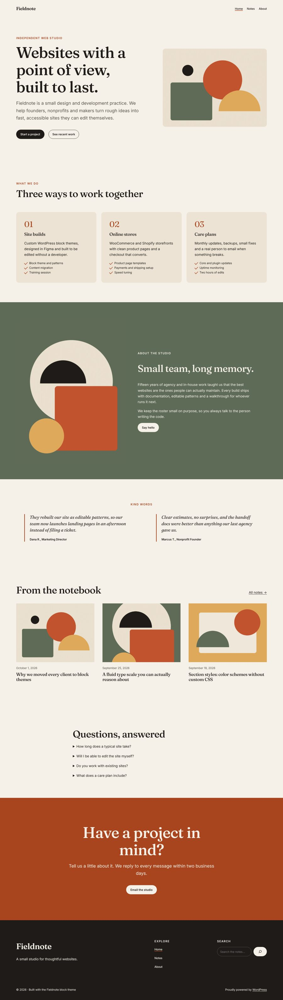
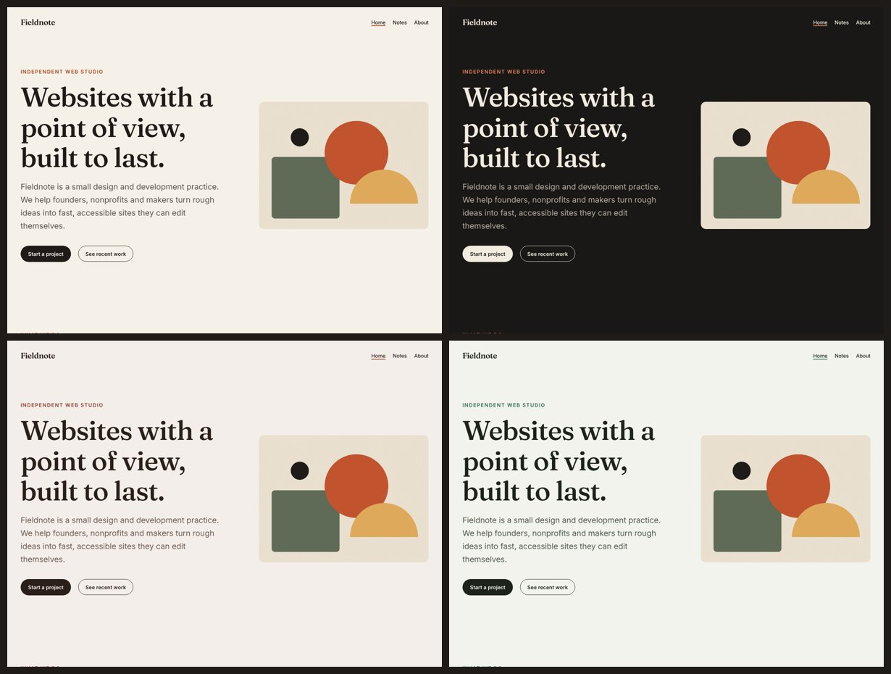
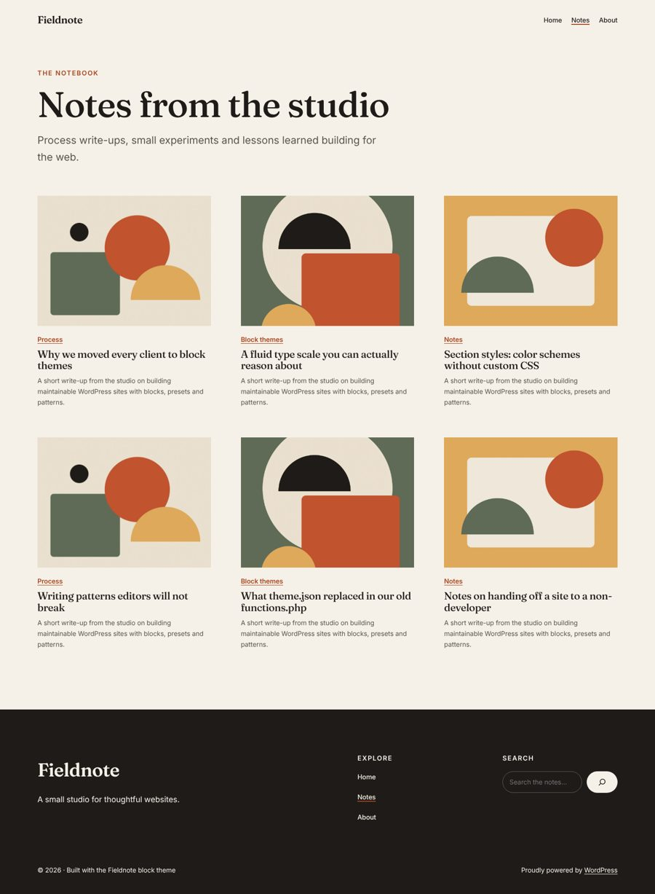
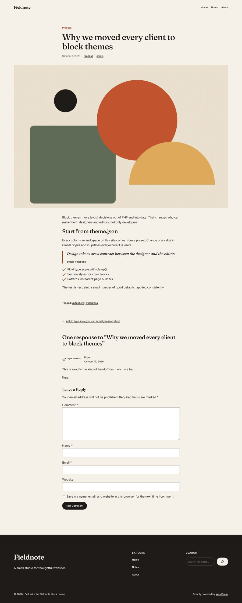
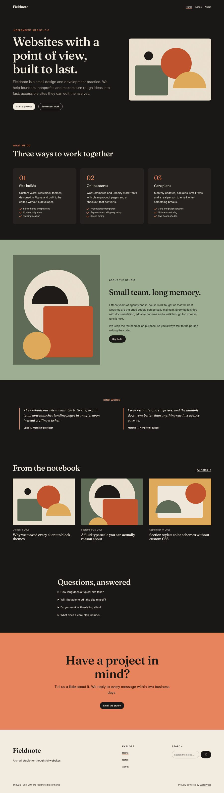
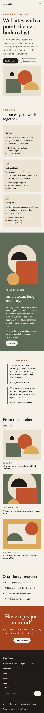

# Fieldnote

A warm, editorial **WordPress block theme** for small studios, freelancers and writers.

Fieldnote is built the modern way: every color, font, size and space is defined in `theme.json`, every page layout is an HTML block template, and every section is a reusable block pattern. There are no classic PHP templates (`header.php`, `single.php`, etc.) and no page builder. Site owners can restyle and rearrange the entire site from **Appearance → Editor** without touching code.



## Highlights

| Area | What it demonstrates |
| --- | --- |
| **`theme.json` (v3)** | Full design token system: 7-color palette, gradients, duotone, fluid type scale with `clamp()`, custom spacing scale, shadow presets, custom properties, layout widths, element styles (links, buttons, headings) and per-block styles. |
| **Bundled variable fonts** | Fraunces and Inter shipped as local `woff2` files and registered through `fontFace` in `theme.json`, so there are no third-party font requests (GDPR friendly) and they appear in the Site Editor font library. |
| **Templates** | 9 HTML templates covering the full template hierarchy: `index`, `home`, `single`, `page`, `archive`, `search`, `404`, plus two custom templates selectable per post/page (`page-landing`, `single-wide`). |
| **Template parts** | `header`, `footer` and a reusable `post-meta` part. |
| **Block patterns** | 16 PHP patterns: 8 insertable sections (hero, services, about, testimonials, recent posts, FAQ, call to action, full landing page) and 8 template-only patterns hidden from the inserter. All strings are translatable and escaped. |
| **Style variations** | `Night` (full variation), `Clay` and `Meadow` (color-only palettes) and `All Serif` (typography-only), using the partial variation support added in WordPress 6.6. |
| **Section styles** | `Ink`, `Clay`, `Sage` and `Paper` color schemes for Group, Columns, Column and Cover blocks, defined purely in JSON (`styles/sections/`). They reference palette presets, so they automatically re-theme inside every style variation. |
| **Performance** | Per-block CSS loaded with `wp_enqueue_block_style()`, so styles for the Button, Navigation or Query blocks are only printed on pages that use them. No jQuery, no front-end JavaScript from the theme. |
| **Accessibility** | Single `header`/`main`/`footer` landmarks, visible `:focus-visible` outlines, `prefers-reduced-motion` support, alt text on all pattern images, AA color contrast in every variation. |
| **Quality tooling** | GitHub Actions CI: PHP syntax on 7.4 and 8.3, WordPress Coding Standards (PHPCS), JSON Schema validation of `theme.json` and every style file, and an installable zip artifact. |

## Style variations

One click in **Styles → Browse styles** swaps the palette across the whole site. Section styles, buttons and links all follow, because nothing hard-codes a color.



<details>
<summary>More screenshots</summary>

**Blog index (`home.html`)**



**Single post (`single.html`)**



**Night variation, full page**



**Mobile**



</details>

## How it is organized

```
fieldnote/
├── theme.json              # Design tokens + global and per-block styles
├── style.css               # Theme header only
├── functions.php           # ~150 lines: pattern categories, per-block CSS, 2 block styles
├── templates/              # HTML block templates
│   ├── index.html  home.html  single.html  page.html
│   ├── archive.html  search.html  404.html
│   └── page-landing.html  single-wide.html   # custom templates
├── parts/                  # header.html  footer.html  post-meta.html
├── patterns/               # PHP block patterns (hidden-* = template only)
├── styles/
│   ├── night.json  clay.json  meadow.json     # style variations
│   ├── typography/all-serif.json               # typography-only variation
│   └── sections/section-*.json                 # section styles
├── assets/
│   ├── fonts/              # Fraunces + Inter variable woff2 (SIL OFL)
│   ├── css/blocks/         # core-button.css etc., loaded per block
│   └── images/             # original artwork used in patterns
└── .github/workflows/ci.yml
```

### A few decisions worth noting

- **Templates stay thin, patterns do the work.** Templates mostly reference patterns (`<!-- wp:pattern {"slug":"fieldnote/hidden-posts-grid"} /-->`). Patterns are PHP, so their text is translatable and the footer's copyright year is always current, while the templates stay pure HTML that the Site Editor can edit.
- **The landing page is a page pattern.** `fieldnote/page-landing` declares `Block Types: core/post-content` and `Post Types: page`, so WordPress offers it in the "Choose a pattern" modal when someone creates a new page. Pair it with the *Landing Page (no title)* template.
- **Section styles instead of hard-coded colors.** The dark footer and colored bands are just a Group with `is-style-section-ink` (or clay, sage, paper). Editors can switch a section's scheme from the Styles panel, and switching the site to the Night variation inverts them correctly with no extra CSS.
- **Only two things needed PHP-registered block styles:** the checkmark list and the eyebrow heading. Both use pseudo-elements or text transforms that `theme.json` cannot express.

## Quality checks

Everything in this repo was verified against a real WordPress 7.1 install before publishing:

- Every template, template part and pattern was loaded in the block editor and parsed with WordPress's own block validator: **0 invalid blocks**.
- All 9 JSON files validate against the official `theme.json` schema.
- `phpcs` with the WordPress ruleset: **0 errors, 0 warnings**.
- Every template returns a 200 (404 for the 404 template) with no PHP notices under `WP_DEBUG`.

Run the same checks locally:

```bash
composer install && composer lint     # WordPress Coding Standards
npm install && npm run lint:json      # theme.json schema validation
npm run zip                           # installable theme zip (dev files excluded via .gitattributes)
```

## Installation

1. Download `fieldnote.zip` from the latest CI run (Actions → *fieldnote-theme* artifact), or run `npm run zip`.
2. In WordPress go to **Appearance → Themes → Add New → Upload Theme**.
3. Activate, then open **Appearance → Editor** to customize.

For local development, clone this repo straight into `wp-content/themes/fieldnote` (works great with LocalWP).

**Requirements:** WordPress 6.6+, PHP 7.4+. Tested up to WordPress 7.1.

## Credits

- [Fraunces](https://github.com/undercasetype/Fraunces) and [Inter](https://github.com/rsms/inter): SIL Open Font License 1.1 (licenses in `assets/fonts/`).
- Pattern artwork: original, created for this theme, GPLv2 or later.

## License

GPLv2 or later. See [LICENSE](LICENSE).

Built by [Jacqui Dyach](https://jacquid.com).
